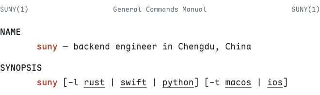

<picture>
  <source media="(prefers-color-scheme: dark)" srcset="assets/header-dark.svg">
  
</picture>

## Description

I build the software I want to use myself: a trading platform in Rust that would rather stop than guess, native apps for the Mac and iPhone, and the small cluster that keeps it all running.

## Projects

**Apple platforms**

- **[PhotoCatalog](https://github.com/euynus/PhotoCatalog)** — A photo manager and RAW editor for the Mac, in the spirit of Lightroom Classic. Face recognition, AI masks and denoising run on-device with Core ML, and the app uses nothing beyond Apple's frameworks. [photocatalog.gooday.dev](https://photocatalog.gooday.dev)
- **[Days Remember](https://github.com/euynus/DaysRemember)** — A Chinese-language iOS app for anniversaries and countdowns: lunar-calendar dates, Home Screen widgets, iCloud sync and cards worth sharing. [days.gooday.dev](https://days.gooday.dev)

**Trading systems**

- **Astra** *(private)* — Multi-venue market data and quantitative trading in Rust. Live trading, paper trading and replay run the same decision code, and risk checks fail closed when data is missing or stale.

**Infrastructure**

- **Homelab** — Nine VPSes across several providers and one Debian box at home, joined by Tailscale and running K3s, watched by Prometheus and Grafana. Self-hosted Actions runners do the heavy Rust builds.
- **[nvim](https://github.com/euynus/nvim)** — The Neovim config every one of those machines shares.

## Environment

- **Languages** — Python · Rust · Swift · TypeScript · Go
- **Backend & data** — FastAPI · Django · Celery · PostgreSQL · MongoDB · ClickHouse · Redis
- **Apple** — SwiftUI · AppKit · SwiftData · WidgetKit · CloudKit
- **Operations** — Docker · K3s · Tailscale · Prometheus · Grafana · GitHub Actions
- **Desk** — Ghostty · Otty · tmux · Neovim · Xcode · uv · gh

## See also

[suny.me](https://www.suny.me) (writing, in Chinese) · [X @euynuss](https://x.com/euynuss) · [Telegram](https://t.me/euynus) · [contact@suny.me](mailto:contact@suny.me)

The header is set in Maple Mono, the font in my terminal, and drawn by [`scripts/header.py`](scripts/header.py).
